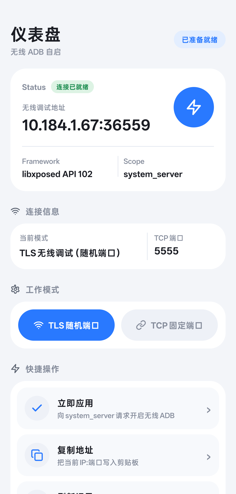

# WirelessAdb-LSPosed

**LSPosed 模块**：开机首次解锁后自动开启无线 ADB，并在状态页查看地址与日志。

包名：`dev.wirelessadb.autostart`  
当前版本：`1.2.3`（libxposed API 102 迁移版，面向一加 15 / ColorOS 17 / Android 17；状态页已重构为 FLClash 风格单页 Dashboard，统一线性图标，无底部导航）

<p align="center">
  
</p>

## 这次改了什么

| 项 | 1.0.18（legacy） | 1.1.1 |
|---|---|---|
| 框架接口 | Xposed API 82，`assets/xposed_init` + `xposedminversion` | **libxposed API 102**，`META-INF/xposed/java_init.list` + `module.prop` |
| 入口 | `IXposedHookLoadPackage.handleLoadPackage("android")` | `XposedModule.onModuleLoaded` / `onSystemServerStarting` |
| 作用域 | `xposedscope=android`（legacy 侧被反转成 `system`） | `scope.list=system`（system_server；`staticScope=false`，允许在管理器里手动校正） |
| Hook | `XposedBridge.hookAllMethods` + `XposedHelpers` | `hook(Executable).intercept` + 标准反射 + `deoptimize` |
| 日志 | `XposedBridge.log` | `log(priority, tag, msg)`，同时回写状态页 |
| TLS 端口 | 只读 `service.adb.tls.port` 属性 | 属性 → `AdbService.getAdbWirelessPort()` → `dumpsys adb` 三级探测 |
| 兼容性 | 依赖 legacy 兼容层 | 不依赖 legacy 包，适配 LSPosed 2.1.0+ / Android 17 |

针对 ColorOS 17 / Android 17 的加固：

- Hook 入口改为 `onSystemServerStarting` 直接拿 system classloader，AMS 类名多候选 + `SystemServer` 兜底；`mContext` 取不到时按类型扫描整条继承链。
- 一次性环境探测：把 `adb_wifi_enabled`、`service.adb.tls.port`、`init.svc.adbd`、Settings.Global 里所有 adb/wifi 相关项、`AdbService` / `AdbDebuggingManager` / OPlus 扩展类的 wifi 方法签名，以及三条端口探测路径的实测结果写进状态页日志（`[诊断]` 前缀），不臆造未验证的字段。
- 连续回退抑制：Android 17 的 **ADB Wi-Fi 2.0** 会在非信任网络自动关闭无线调试，ColorOS 也可能忽略 `Settings.Global` 写入。60 秒内连续 3 次被回退即暂停自动写回并给出提示，避免与系统策略拉锯。
- TCP 模式增加属性回读校验；IP 获取额外跳过 `198.19.*`（fake-ip VPN）虚拟地址。
- 状态页日志预览从 6 行扩到 12 行，并明确提示「模块未加载」。

### 1.1.1：修复 Android 17 上「端口=-1」

实机验证（一加 15 / PLK110 / ColorOS V17.0.0 / LSPosed 2.2.1）确认 1.1.0 的 API 102 迁移完全生效：

```
[框架] 模块已加载 process=system systemServer=true framework=LSPosed/2.2.1(7939) api=102 capSystem=true
[框架] 已 hook com.android.server.am.ActivityManagerService.systemReady，成功 1/1
[框架] 已取得系统 Context（来源 com.android.server.am.ActivityManagerService）
```

但 `获取地址失败：IP=10.184.1.67，端口=-1` 依旧。根因：Android 17 **不再把 TLS 端口写进 `service.adb.tls.port`**，端口由 `AdbService.getAdbWirelessPort()` 提供（`dumpsys adb` 输出里的 `tls_port=34221` 就是它）。1.1.0 只读属性，所以地址永远拼不出来。

1.1.1 改为三级探测并缓存 5 秒，命中时写 `[端口] TLS 端口=… 来源=…`：

1. `service.adb.tls.port` 系统属性（旧 ROM 兼容）；
2. `ServiceManager.getService("adb")` → `IAdbManager$Stub.asInterface` → 反射 `getAdbWirelessPort()`；
3. 兜底执行 `dumpsys adb`，正则解析 `tls_port=(\d+)`（应对 OEM 改写 AdbService）。

实机验证（2026-11-10，一加 15 / ColorOS V17.0.0 / LSPosed 2.2.1，重启后自动重连）：

```
[诊断] TLS 端口来源探测：属性=-1, AdbService=0, dumpsys=-1     ← 开机早期端口尚未分配
[端口] TLS 端口=36559，来源：AdbService.getAdbWirelessPort
无线 ADB 地址已就绪，等待微信输入法启动后复制：10.184.1.67:36559
```

同一时刻 `dumpsys adb` 的 `adb_wifi.tls_port=36559`，`adb connect 10.184.1.67:36559` 成功 —— 三条证据一致。

诊断还确认 ColorOS 17 在 `AdbService` 上加了定制方法 `disableADBdWifi()` / `enableADBdWifi()` / `isAdbWifiQrSupported()` / `isAdbWifiSupported()`；当前通过 `Settings.Global.adb_wifi_enabled` 写入已能正常开启，暂不调用这些 OEM 私有方法。

## 环境要求

- **LSPosed ≥ 2.1.0**（提供 libxposed API 102、兼容 Android 17）。低于该版本不提供 API 102，本模块不会加载。
- 已 root（KernelSU/Zygisk Next 等）且 LSPosed 能注入 system_server。
- 目标机型：一加 15 / ColorOS 17（Android 17 / API 37）；其它 Android 11+ 设备理论上同样可用。

> 注意：API 102 模块与 legacy API 82 模块在 classloader 层互斥。本版本**不能**与旧版共存，升级时先卸载 1.0.18（若签名冲突则必须卸载）。

## 安装

1. 安装 Release APK（若装过 1.0.18 且提示签名冲突，先卸载旧版）。
2. 在 **LSPosed** 中启用本模块。
3. 作用域确认为 **系统框架 / system**（`staticScope=false`，如管理器里未勾选可手动加上；升级/卸载重装后启用状态与作用域会被清空，需重新勾选）。
4. 重启手机并完成首次解锁。
5. 打开「无线 ADB 自启」状态页，看到 `[框架] 模块已加载` 即代表 hook 生效。

> 仅建议在可信局域网使用。切换 TCP 会重启 adbd，当前 ADB 会话可能断开。重启后 TLS 端口会重新随机，电脑端可用 `adb mdns services` 自动发现新地址后再 `adb connect`。

## ColorOS 17 / Android 17 必查项

即使模块已加载，下列系统策略仍可能让无线 ADB 被关闭：

1. **开发者选项 → 关闭「权限监控」/「禁止系统优化」**（ColorOS 对 ADB 的已知限制）。
2. **无线调试 → 把当前 Wi-Fi 标记为「始终允许」**。ADB Wi-Fi 2.0 以 SSID+BSSID 判定可信网络，陌生/公共 Wi-Fi 会自动关闭无线调试。
3. 确认 **USB 调试** 已开启；TLS 模式下电脑端用 `platform-tools ≥ 37.0.0` 的 `adb pair` / `adb connect`。
4. 状态页若出现 `[警告] 60 秒内连续 3 次被系统回退`，说明是策略性关闭，模块已停止写回，需按上面两项处理后再点「立即应用」。

## 排障

| 现象 | 检查 |
|---|---|
| 状态页显示「模块未加载」 | LSPosed 版本是否 ≥ 2.1.0；模块是否启用；作用域是否含系统框架；是否被隐藏/root 检测模块干扰 |
| 有 `[框架] 模块已加载` 但无 `[框架] 已取得系统 Context` | 查看 `[警告]` 里的候选字段与 LSPosed 日志，反馈给维护者 |
| `获取地址失败…端口=-1` | 看 `[诊断] TLS 端口来源探测`：若 `AdbService` 与 `dumpsys` 均为 -1，说明该 ROM 改了 AIDL 或禁止 system_server 执行 dumpsys，把该行回传 |
| `adb_wifi_enabled` 写入后回读不为 1 | ColorOS 忽略写入，走可信网络 + 权限监控两项设置 |
| TCP 5555 连不上 | 看 `[诊断]` 里 `tcp.port` 回读值与 `adbd` 状态；Android 17 重写了 adbd，必要时改用 TLS 模式 |

LSPosed 的详细日志 tag 为 `WirelessAdbAutoStart`，也可直接读 `/data/adb/lspd/log/modules_*.log`。

## 构建

```bash
./gradlew :app:assembleRelease
```

产物：`app/build/outputs/apk/release/app-release.apk`

需要 Android SDK（`local.properties` 的 `sdk.dir` 或 `ANDROID_HOME`）与 JDK 17+。当前 `compileSdk/targetSdk = 36`：framework 侧全部走反射，不依赖编译期 Android 17 API，无需 SDK platform 37 即可构建。

验证 APK 声明是否打进包：

```bash
unzip -l app/build/outputs/apk/release/app-release.apk | grep META-INF/xposed
```

应看到 `module.prop`、`java_init.list`、`scope.list` 三个文件，且不应再出现 `assets/xposed_init` 与 `xposedminversion`。

## 许可

MIT
